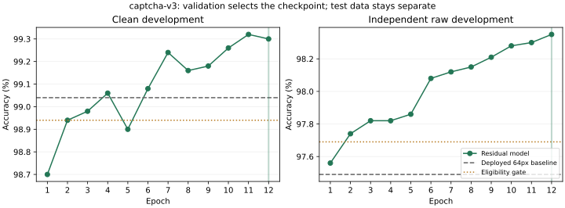

# Compact residual digit experiment

The `captcha-v3` experiment tests whether residual capacity and broader synthetic
training improve the deployed `captcha-v2` model. The website stays on v3.6.0
until the candidate passes the gates below. No official challenge image, answer
or generator is used for training, validation or selection.

## Protocol fixed before results

Keep the existing 64px preprocessing, original stratified 55,000/5,000 MNIST
source split and baseline checkpoint. Add bottleneck residual blocks after the
first pooling layer (16 maps at 32px) and the final average pooling layer
(32 maps at 8px). Each block reduces channels by half with a 1x1 convolution,
uses a 3x3 convolution, expands with 1x1, then adds the skip connection and ReLU.
The expand weights start at zero, preserving the baseline exactly before training.
Dense128, ten outputs and dropout 0.25 remain. No batch normalization is needed
in the browser. The displayed feature maps are actual post-residual activations.
The candidate has 272,618 parameters versus 268,362 in the baseline, adding
4,256 parameters (17,024 bytes as float32 weights).

Train 12 fixed epochs, each with 40,000 new raw synthetic images and 20,000
clean handwritten samples. Half of raw samples use printed glyphs. Mix the
previous independent renderers: 40% broad lines/arcs, 40% nonsquare canvases
with gradients/wavy curves, 20% original simple corruption. Independently add
mild blur, scan noise and JPEG artifacts with 30% probability each. Use seed
20261123, AdamW at 0.0003, weight decay 0.0001, batches of 128 and cosine decay
to 0.00002. Keep four CPU threads and deterministic PyTorch operations.

Expand training to 36 font faces by adding DejaVu Serif, Liberation Mono,
Palatino, Gadugi and Malgun. Reserve California, Centaur, Leelawadee UI and
Noto Sans for development; reserve High Tower Text, Lucida Typewriter,
Sylfaen and Yu Gothic for the fresh test. Prior challenge, high-resolution and
ensemble held-out font families remain excluded from training.

Use 10,000 independently rendered development samples (seed 20261124).
Select the lowest raw development loss among epochs that gain at least **0.2
percentage points** raw accuracy against the baseline while losing at most
**0.1 points** on clean development data. Save the choice before opening test
data. If no epoch qualifies, retain the baseline without opening the test.

Export the fixed development choice and require browser/Python logits, hidden
units and both feature layers to agree within 0.0001. Require desktop Edge
p95 inference below 150ms before opening the fresh test. Timing uses 40 runs
after warm-up per model; it does not establish physical-phone performance.

Only then evaluate both frozen models on the same 20,000 fresh raw synthetic
images (seed 20261125), distinct test font families and the canonical 10,000
clean MNIST test images. Require the same 0.2-point raw gain and 0.1-point clean
tolerance for deployment. Synthetic data is not collected real CAPTCHA data;
canonical MNIST test images have been used in earlier historical evaluations.
Also report how many baseline errors the candidate fixes and how many correct
baseline predictions it breaks, with a paired bootstrap interval (10,000 draws,
seed 20261126). This interval is diagnostic and does not add a selection gate.

For a qualifying candidate, run full upload/drawing, Letters, Words entry,
helper, export and mobile-layout regression checks before deployment. Freeze
the runtime and weights before the separately identified official challenge
follow-up. Do not tune after reading that result. Preserve previous releases,
failed candidates and all evaluation evidence.

## Commands

Run from `dia2-local/` using the installed environment and Windows fonts:

```powershell
.\.venv\Scripts\python.exe -m digitlab.residual
.\.venv\Scripts\python.exe -m unittest discover -s tests -v
# After training selects an eligible epoch:
.\.venv\Scripts\python.exe -m digitlab.residual_evaluate --stage export
# Start serve.py --port 8770 in another terminal.
.\.venv\Scripts\python.exe -m digitlab.residual_qa
.\.venv\Scripts\python.exe -m digitlab.residual_evaluate --stage test
```

The trainer and test stages refuse to replace completed evidence. Checkpoints,
raw fixtures, fonts and weights are not committed. Training history, font and
generator hashes, policy and the frozen selection are recorded separately.

## Results

Epoch **12** was selected before opening the fresh test. The frozen candidate
passed both accuracy gates and all local browser checks.

| Evaluation | v3.6.0 baseline | Residual v3.7.0 |
| --- | ---: | ---: |
| Clean MNIST, 10,000 images | 9,891 (98.91%) | 9,910 (99.10%) |
| Fresh raw synthetic, 20,000 images | 19,623 (98.115%) | 19,746 (98.73%) |
| Official challenge follow-up | 9/10 | 10/10 |

The raw comparison uses identical images for both models. The candidate fixed
159 baseline errors and introduced 36, gaining 123 correct predictions. The
paired bootstrap interval for the accuracy gain is 0.475–0.755 percentage
points, conditional on this synthetic distribution. This is separate from the
earlier high-resolution and ensemble benchmarks, whose distributions differ.

The official follow-up ran once after freezing source and model identities.
Prior outcomes were known; **10/10 is not a fresh blind evaluation or a promise
for arbitrary CAPTCHA images**. No training, preprocessing or inference changes
followed that result.

Weight SHA-256:
`d962c7f1aefd4f86cf9fcc621e30a1e8fbbce092c5a47ab3dd88e0f64573b42c`.



**PASS:** 28 Python tests, browser/Python logits and intermediate activations,
36 digit/letter uploads, 60 full-pipeline synthetic uploads, filename
independence, drawing, mixed exports, invalid input handling, failed-download
recovery, cached v3.5/v3.6 entry points, mode dimensions, Words entry, mobile
layout, six helper groups and 19 Words UI groups. Words worker checks use a
test double; real TrOCR and physical-phone performance are **NOT RUN** here.

Before the fresh test, selected-model desktop Edge inference measured
66.9ms median / 83.0ms p95 (baseline: 57.9ms / 84.7ms). The later full-runtime
check measured 64.9ms / 75.4ms (baseline: 55.7ms / 64.1ms). Each comparison
uses 40 timed inferences per model after warm-up on this machine.

Evidence: [training and test](../reports/captcha-v3.json),
[archived pre-test selection and gate](../reports/captcha-v3-development-selection.json),
[pre-test speed gate](../reports/captcha-v3-speed-qa.json),
[character regression](../reports/captcha-v3-browser-qa.json),
[raw uploads](../reports/captcha-v3-raw-browser-qa.json),
[runtime and cached releases](../reports/captcha-v3-runtime-qa.json),
[helper](../reports/captcha-v3-helper-qa.json),
[Words UI](../reports/captcha-v3-words-qa.json),
[challenge freeze](../reports/captcha-v3-challenge-freeze.json),
[challenge comparison](../reports/captcha-v3-challenge-comparison.json) and
[public aggregate summary](../dist/evaluation/digits-captcha-v3.json).

Raw local and public challenge exports are preserved locally under `reports/`
with their recorded SHA-256 identities. They contain normalized image pixels
and are excluded from this commit; summaries and verification records are shared.

The training/test report and manifest describe their state when test scoring
finished (UI QA still pending at that point); the later separate QA and freeze
records establish release readiness. Historical measurement records are retained.
The runtime collector's generic “before fresh test” scope text describes its
speed-gate use; reports with full `interface` checks were collected afterward
with `--interface`, as documented above.

## Public deployment verification

Release **v3.7.0** is live at [Digit Lab](https://naoquerosaber.pt/AI/).
All **nine changed uploads** passed verified FTPS transfer with replacement
backups. All **50 HTTPS static asset hashes**, JavaScript MIME types and frozen
source hashes passed independent verification.

Fresh public Edge sessions passed 36 digit/letter uploads, 60 raw synthetic
uploads, real drawing, Python parity, dimensions, cached previous models,
mobile layout, six helper groups and 19 Words UI groups. Public desktop
inference measured 68.3ms median / 78.6ms p95 (baseline: 69.3ms / 75.6ms), with
40 timed inferences per model after warm-up. Timing variation prevents a claim
that the new model is faster.

All ten official images were uploaded directly on the live website: **10/10
correct**, with every prediction, prepared input and score matching the frozen
local evaluation. This verifies deployment of the evaluated model; it is not
another independent accuracy test. No tuning followed either challenge run.

Evidence: [FTPS transfer](../reports/release-3.7.0-ftp-deployment.json),
[all HTTPS assets](../reports/release-3.7.0-http-assets.json),
[public character checks](../reports/release-3.7.0-public-character-qa.json),
[public raw uploads](../reports/release-3.7.0-public-raw-qa.json),
[public runtime and speed](../reports/release-3.7.0-public-runtime-qa.json),
[public helper](../reports/release-3.7.0-public-helper-qa.json),
[public Words UI](../reports/release-3.7.0-public-words-qa.json),
[direct live challenge verification](../reports/release-3.7.0-public-challenge-verification.json).

The development runtime fixture uses nonzero residual blocks to exercise real
skip additions. It passed browser/Python activation parity and measured 92.3ms
median / 110.3ms p95 under concurrent training load (baseline: 86.2ms / 97.9ms).
These are integration measurements for an untrained fixture, not selected-model
accuracy or release speed claims. See [the development runtime check](../reports/captcha-v3-development-runtime-qa.json).

Before changing the default model, all 28 Python tests, the
[baseline character regression](../reports/captcha-v3-baseline-regression-qa.json),
[six helper groups](../reports/captcha-v3-baseline-helper-qa.json) and
[19 Words UI groups](../reports/captcha-v3-baseline-words-qa.json) passed.
The Words worker checks use an explicit test double; real TrOCR inference was
not rerun because its weights and runtime are unchanged. Its initial collector
[fixture mismatch](../reports/captcha-v3-baseline-words-initial-attempt.json) is
preserved separately; the checker now accepts a matching digit experiment and
verifies the model hash before comparing activations.
