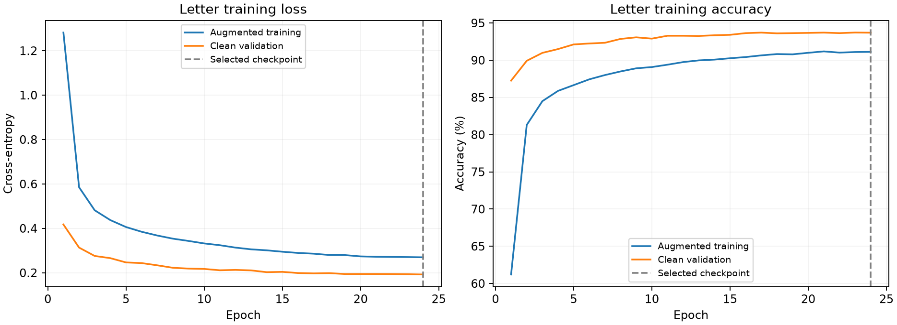
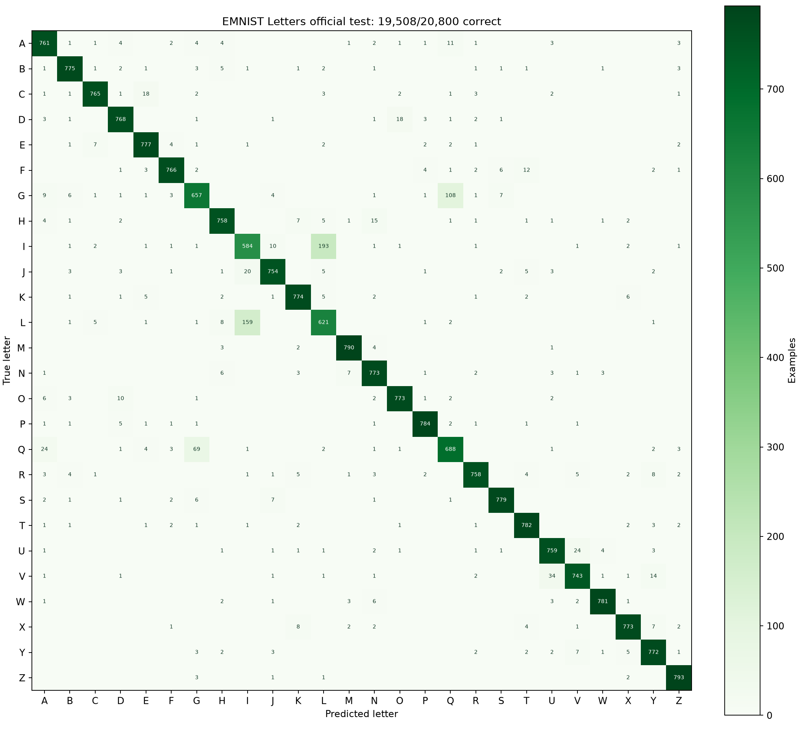

# Letters Mode — Validation

## Measured result

The dedicated A–Z CNN correctly classified **19,508/20,800 official EMNIST Letters test examples (93.79%)**. Macro precision: 93.80%; macro recall: 93.79%; macro F1: 93.79%.

The original digit model is unchanged: 99.28% on the official MNIST test. Its original Desafio result remains 2/10. Adding letter recognition does not improve or replace that independent challenge result.

## Data and method

The [official NIST EMNIST Letters dataset](https://www.nist.gov/itl/products-and-services/emnist-dataset) merges uppercase and lowercase forms into 26 classes. Labels are presented as A–Z. This model recognizes one handwritten character at a time; it does not distinguish case or read words.

The NIST archive was verified against the canonical MD5 published in torchvision: `58c8d27c78d21e728a6bc7b3cc06412e`. Extracted file SHA-256 values are recorded in the training provenance. Stored image axes are transposed to upright handwriting; a training-only sample sheet was visually checked before training.

Seed: 20261017. Official training examples: 124,800. Split: 114,400 train / 10,400 validation, reserving 400 per class. Training used 24 epochs, AdamW, batch 256, recorded affine/noise augmentation, and the same preprocessing contract as the browser. The checkpoint was selected at epoch 24 by minimum validation loss. The 20,800 official test examples were loaded only after selection.

Unreadable official training inputs: 0; unreadable official test inputs: 0. Such examples, if present, remain in benchmark counts as zero-input predictions; the interactive app rejects blank uploads rather than inventing a character.

Letter weight SHA-256: `c35d6fece31dbbacb37d684d3c256fbf634bf90751195fff8238f28e884f0ad5`.

## Browser behavior and correctness

All 10 letter QA groups passed. These cover original digit weight identity and runtime parity, all 26 letter outputs and intermediate activations, 26 uploaded examples compared against Python, mode changes and saved-result identity, drawing, mixed-mode export, mobile layout, recovery from a model-loading failure, and browser-only inference.

Maximum letter logit difference on the 26 fixtures: `6.675720215e-06` (tolerance 0.0001). Each uploaded result identifies its recognition mode, label order, model hash, scores, and prepared pixels. A saved result switches back to its own model when selected, preventing an activation display from using the wrong weights.

The update is published at **https://naoquerosaber.pt/AI/index.html**. All nine [digit regression groups](public-browser-qa-v2.json) and all ten [letter verification groups](public-letters-browser-qa.json) passed on the public HTTPS site. The deployment downloaded and SHA-256-verified every uploaded asset. No training data, parity fixtures, or credentials were uploaded.

Digits and Letters are explicit modes because O/0 and I/1 can be visually ambiguous. A classifier constrained to A–Z will still choose a letter for an out-of-domain input; it is not a general detector of whether an image contains a valid letter. Softmax outputs are not calibrated certainty.

## Per-class official test metrics

| Class | Test examples | Precision | Recall | F1 |
| --- | --- | --- | --- | --- |
| A | 800 | 92.80% | 95.12% | 93.95% |
| B | 800 | 96.63% | 96.88% | 96.75% |
| C | 800 | 97.70% | 95.62% | 96.65% |
| D | 800 | 95.88% | 96.00% | 95.94% |
| E | 800 | 95.57% | 97.12% | 96.34% |
| F | 800 | 97.46% | 95.75% | 96.60% |
| G | 800 | 86.90% | 82.12% | 84.45% |
| H | 800 | 95.71% | 94.75% | 95.23% |
| I | 800 | 76.04% | 73.00% | 74.49% |
| J | 800 | 96.05% | 94.25% | 95.14% |
| K | 800 | 96.39% | 96.75% | 96.57% |
| L | 800 | 73.84% | 77.62% | 75.69% |
| M | 800 | 98.14% | 98.75% | 98.44% |
| N | 800 | 94.38% | 96.62% | 95.49% |
| O | 800 | 96.87% | 96.62% | 96.75% |
| P | 800 | 97.88% | 98.00% | 97.94% |
| Q | 800 | 83.90% | 86.00% | 84.94% |
| R | 800 | 97.06% | 94.75% | 95.89% |
| S | 800 | 97.74% | 97.38% | 97.56% |
| T | 800 | 96.07% | 97.75% | 96.90% |
| U | 800 | 93.24% | 94.88% | 94.05% |
| V | 800 | 94.65% | 92.88% | 93.75% |
| W | 800 | 98.61% | 97.62% | 98.12% |
| X | 800 | 97.11% | 96.62% | 96.87% |
| Y | 800 | 94.84% | 96.50% | 95.66% |
| Z | 800 | 97.42% | 99.12% | 98.27% |

Largest off-diagonal confusion counts: I→L: 193, L→I: 159, G→Q: 108, Q→G: 69, V→U: 34, U→V: 24, Q→A: 24, J→I: 20, D→O: 18, C→E: 18. These are observed errors; no per-letter accuracy guarantee is made for arbitrary handwriting or fonts.

## Preserved baseline and release

The original digit model, raw challenge predictions, and frozen application archive were retained. This is a later application version, not a replacement for the first independent challenge evaluation. Original root JavaScript/CSS assets remain available for cached v1 pages; the new interface uses versioned `v2/` assets. Deployment uploads model/dependency assets before switching `index.html`.

## Evidence

- [Training history](letters-training.json)
- [Official test metrics and error indices](letters-test.json)
- [Local browser checks](letters-browser-qa.json)
- [Training orientation check](letters-training-orientation.png)
- [Original digit/Desafio evaluation](validation.md)

Dataset citation: Cohen, Afshar, Tapson, and van Schaik (2017), [EMNIST: an extension of MNIST to handwritten letters](https://arxiv.org/abs/1702.05373).
