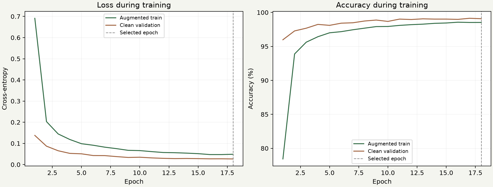
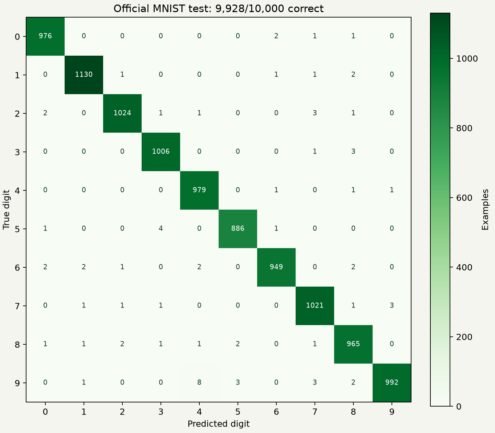
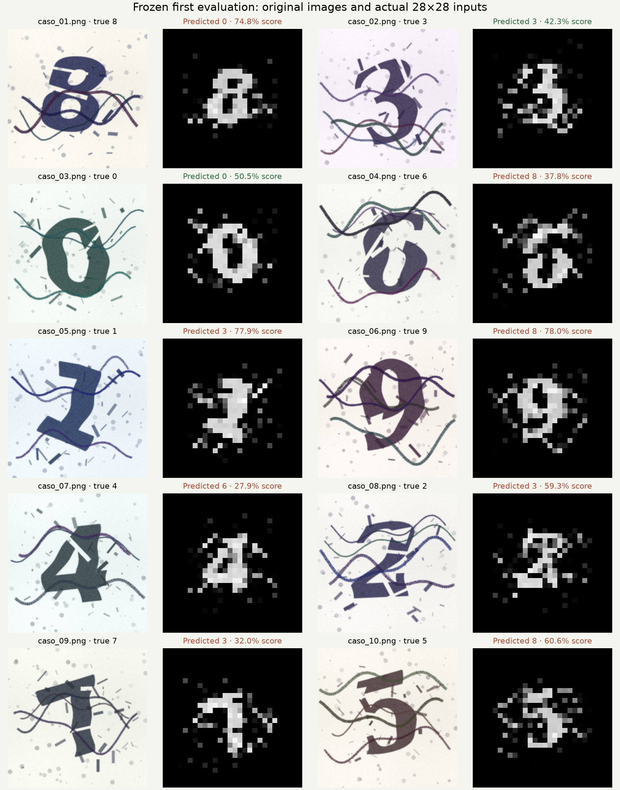

# Local Desafio Validation Report

## Measured outcome

- **Official MNIST test:** 9,928/10,000 correct (**99.28%**), with 72 errors.
- **Official CAPTCHA challenge:** 2/10 correct (**20%**), with 8 errors.
- **Scope:** local Edge browser at `http://127.0.0.1:8765`. No public deployment or teacher evaluation is claimed.

The model performs well on clean MNIST but is not reliable on these noisy CAPTCHA images. A 99.28% MNIST result must not be presented as CAPTCHA accuracy. The CAPTCHA sample contains only ten examples and does not establish population accuracy.

## Reproducibility and independence

Seed: 20261016. Stratified split: 55,000 training / 5,000 validation. AdamW, batch 256, 18 epochs, recorded affine/noise augmentation. The checkpoint was selected by lowest validation loss at epoch 18; the official test set was loaded only afterward.

Model weight SHA-256: `8e9021e5ba3cb33a66e3dc8b8580a7388802a6938dd78162ebcee4c396e84338`.

Frozen application source-tree SHA-256: `e785ddc862f1b4f3f57834f29f33977da7dd79edda23cbb9a4c326e0b5948f6e`.

Raw prediction record SHA-256: `de678c7d21b0e102d4396824192789b005cdb0bb6b38a42acf3171a2cf5b45dc`.

The actual inference application and weights were frozen before challenge uploads. Labels were inspected only after `challenge-raw.json` was durably written. The answer key was obtained by parsing the generator's literal `DIGITS` assignment; the generator was not executed and course images were not modified. No model or preprocessing changes followed the challenge result.

The first collection attempt stopped before writing predictions because a collector assertion rejected browser-local `blob:` preview URLs. The retry changed only the collector, verified the original frozen inference sources and archive, and used the same model and input pipeline. The original freeze and the repaired collector hash are preserved. This was a collection retry, not a new trained model or a tuned second evaluation.

## Runtime verification

- All six Python tests passed, covering real data separation, preprocessing, finite gradients, learning behavior, and export integrity.
- All nine browser QA groups passed, including all-class model parity, five preprocessing fixtures, ten MNIST uploads, filename independence, invalid/blank uploads, pointer drawing, real visualization, export, mobile layout, and browser-only requests.
- Maximum logit difference on ten clean parity fixtures: `3.814697266e-06` (required ≤ 0.0001).
- All five synthetic preprocessing fixtures matched exactly.
- Each challenge input matched Python preprocessing exactly; maximum challenge logit difference: `1.430511475e-06`. Predicted classes matched for all ten.
- The app issued only static local GETs and local blob preview reads. No inference or image-upload API was used.

## First challenge predictions

Scores below are softmax outputs for the predicted class, not calibrated correctness probabilities. Full ten-class scores and prepared inputs are preserved in the raw record.

| Image | Expected | Predicted | Predicted-class score | Result |
| --- | --- | --- | --- | --- |
| caso_01.png | 8 | 0 | 74.7776% | Incorrect |
| caso_02.png | 3 | 3 | 42.3382% | Correct |
| caso_03.png | 0 | 0 | 50.4811% | Correct |
| caso_04.png | 6 | 8 | 37.8438% | Incorrect |
| caso_05.png | 1 | 3 | 77.8994% | Incorrect |
| caso_06.png | 9 | 8 | 78.0492% | Incorrect |
| caso_07.png | 4 | 6 | 27.8941% | Incorrect |
| caso_08.png | 2 | 3 | 59.3337% | Incorrect |
| caso_09.png | 7 | 3 | 31.9791% | Incorrect |
| caso_10.png | 5 | 8 | 60.5539% | Incorrect |

## Error analysis

**Observed:** eight challenge errors remain despite matching browser/Python inputs and logits. High softmax scores can be wrong: for example, case 05 selects 3 rather than 1 with a score above 77%. Runtime mismatch is not supported as the cause of these recorded errors.

**Observed:** the prepared inputs contain interference and peripheral marks. The shared preprocessing crops visible foreground without identifying which marks belong to the digit, so clutter participates in scaling and centering. Training augmentation covers modest affine variation and mild noise, not the full challenge distribution.

**Hypotheses:** distribution shift, damaged glyph topology, unfamiliar font shapes, and background strokes likely contribute. The contribution of each factor has not been isolated experimentally. The first evaluation remains unchanged; no challenge-dependent cleanup or retuning was performed.

Largest official MNIST off-diagonal confusion counts: 9→4: 8, 5→3: 4, 9→7: 3, 9→5: 3, 7→9: 3. See the complete matrix for class support and all error counts.

## Figures and evidence

- [Training history](training.json)
- [MNIST test metrics and error indices](mnist-test.json)
- [Browser QA](browser-qa.json)
- [Frozen source/model identity](challenge-freeze.json)
- [Unmodified raw predictions](challenge-raw.json)
- [Separate label comparison and challenge parity](challenge-comparison.json)
- [Local interface screenshot](screenshots/desktop.png)
- [All ten challenge uploads](screenshots/challenge-all.png)

## Completion matrix

| Requirement | Status | Evidence |
| --- | --- | --- |
| Real training and held-out MNIST evaluation | PASS | Training history, checkpoint, metrics |
| Exported weight identity | PASS | Manifest, SHA-256, export test |
| Origin/browser parity | PASS | Clean and challenge comparisons |
| Drawing, clear, and image upload | PASS | Browser QA, screenshots |
| Ten challenge previews and predictions | PASS | Raw record and screenshots |
| Browser-only inference | PASS | Network request records |
| Actual feature maps and output contributions | PASS | QA and interface |
| Independent initial prediction recording | PASS | Freeze, raw hash, separate comparison |
| CAPTCHA recognition | 2/10 CORRECT | Raw predictions and answer key comparison |
| Public GitHub Pages deployment | NOT RUN | User requested local-only work |
| Teacher feedback | NOT RUN | Requires a real review session |

## Next steps

Use the application locally and retain the frozen baseline. Any future robustness work must use independently sourced training/validation examples, keep these ten PNGs out of tuning, and report subsequent challenge comparisons as post-inspection iterations. Public deployment and teacher review can be added later without rewriting the initial evaluation.
